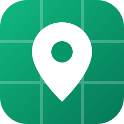
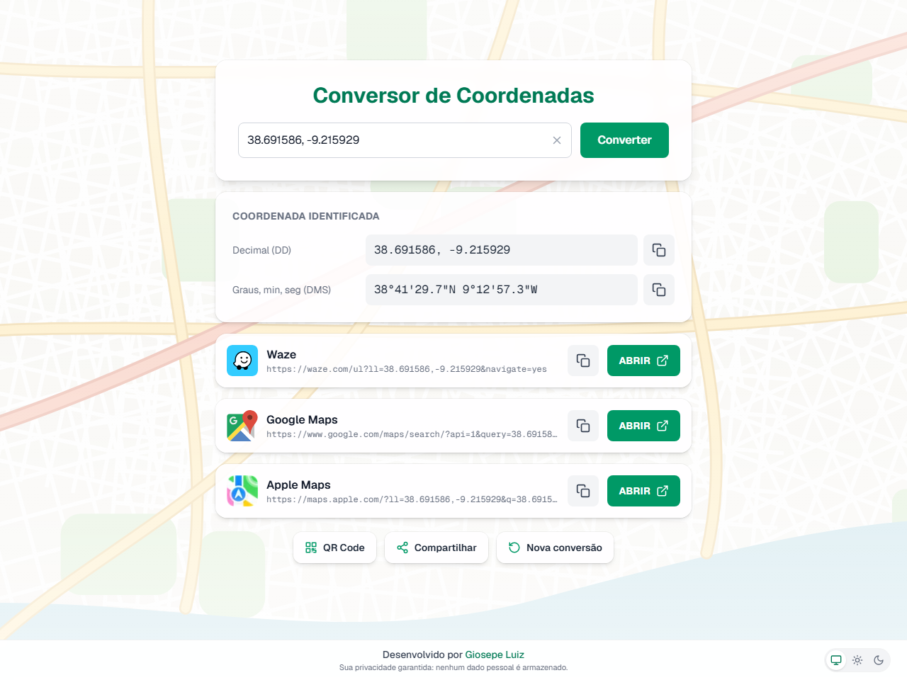
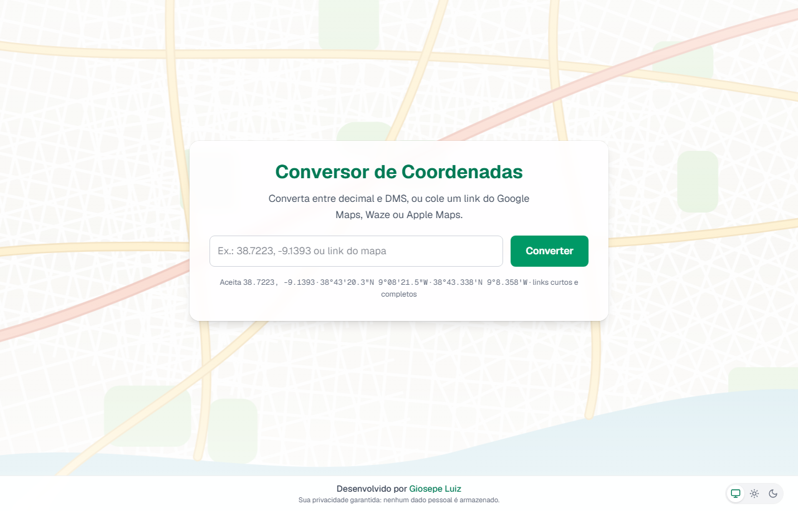
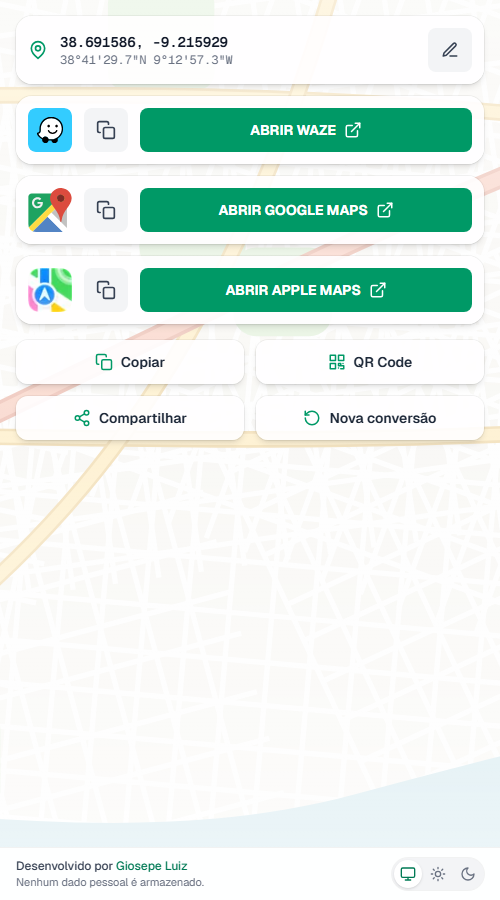
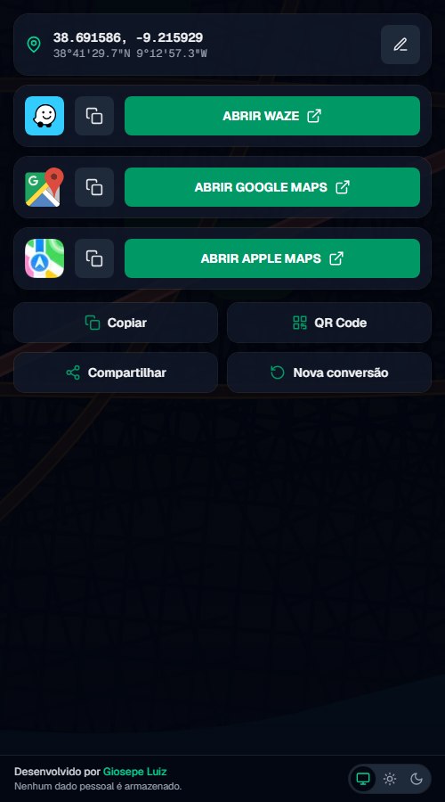
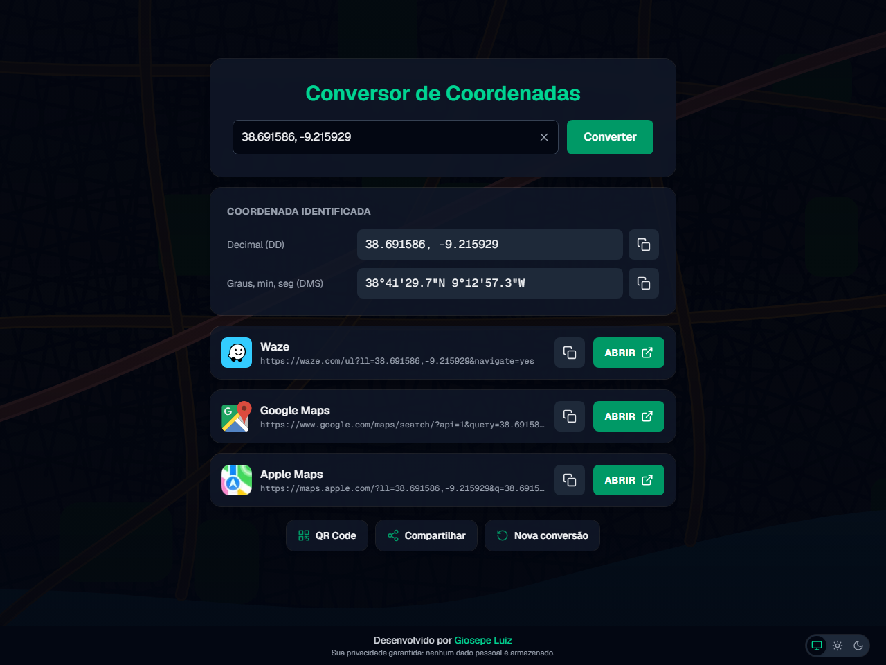

<div align="center">



# Conversor de Coordenadas

### Cole uma coordenada ou um link de mapa e abra no Waze, Google Maps ou Apple Maps em um toque.

[](https://coordenadas.arqueirover.de)
[](https://nextjs.org)
[](https://react.dev)
[](https://www.typescriptlang.org)
[](https://tailwindcss.com)

**[🌐 Abrir o site](https://coordenadas.arqueirover.de)** · **[📖 Como usar](#-como-funciona-passo-a-passo)** · **[🕰️ Versões](#️-histórico-de-versões)** · **[🤝 Contribuir](#-código-aberto-contribua)**



</div>

> 🇬🇧 **English summary:** *Conversor de Coordenadas* is a free web app that converts geographic coordinates between decimal degrees (DD) and degrees-minutes-seconds (DMS), and opens the location in Waze, Google Maps or Apple Maps with one tap. Paste plain coordinates or any Google Maps, Waze or Apple Maps link (short links included), either in the input or right after the site's address. On phones, the buttons open the navigation apps directly. Light, dark or system theme. No sign-up, no tracking.

---

## 👋 Olá!

Sabe quando alguém te manda uma localização e você quer abrir no **seu** app de navegação, mas o link é do Google Maps e você usa o Waze? Ou quando recebe uma coordenada em graus, minutos e segundos e precisa dela em decimal (ou o contrário)? O **Conversor de Coordenadas** nasceu exatamente disso.

Ele é, de propósito, **simples e direto**: você cola o que recebeu (uma coordenada, um link completo ou até um link curto do tipo `maps.app.goo.gl`) e ele mostra a coordenada nos dois formatos, com botões para abrir no **Waze**, no **Google Maps** ou no **Apple Maps**.

No celular, a tela fica bem enxuta: é só tocar no app de destino, e ele abre direto no aplicativo instalado. E tem um truque: dá para colar o link do mapa **depois do endereço do site**, e ele já te devolve a localização limpa.

## ✨ O que ele faz

| | |
|---|---|
| 🔄 **Decimal ↔ DMS** | Mostra sempre os dois formatos: `38.691586, -9.215929` e `38°41'29.7"N 9°12'57.3"W` |
| 🔗 **Lê links de mapas** | Google Maps, Waze e Apple Maps, além de OpenStreetMap, Bing Maps e `geo:` |
| ✂️ **Links curtos também** | `maps.app.goo.gl`, `goo.gl/maps`, `waze.com/ul/h…` e `maps.apple/p/…` |
| 📍 **Lugares por nome** | Um link só com o nome do lugar (ex.: *Torre de Belém*) também vira coordenada |
| 🌐 **Cole na URL do site** | `coordenadas.arqueirover.de/` + o link do mapa → localização limpa |
| 📱 **Abre direto no app** | No celular, os botões chamam o Waze, Google Maps ou Apple Maps instalado |
| 📋 **Copiar com um toque** | A coordenada (em qualquer formato) ou o link de cada app |
| 🔳 **QR Code** | Gera um QR com o link da localização, com botão para baixar a imagem |
| ↗️ **Compartilhar** | Usa a janela de compartilhamento do aparelho (WhatsApp, e-mail…) ou copia o link |
| 🌗 **Tema claro, escuro ou do sistema** | A escolha fica guardada no navegador |
| ⚡ **Rápido e leve** | A página já chega pronta do servidor e o fundo de mapa tem só 5 KB |
| ♿ **Acessível** | Funciona por teclado, com leitor de tela e respeita "reduzir movimento" |
| 🔒 **Privado** | Sem cadastro, sem login e sem guardar nada seu |

## 🌐 Use agora

É só acessar **[coordenadas.arqueirover.de](https://coordenadas.arqueirover.de)**. Funciona no computador e no celular, em qualquer navegador moderno, sem instalar nada.

> 💡 **Dica:** no celular, use **Compartilhar → Adicionar à tela de início** para ter um atalho direto para o conversor.

## 📖 Como funciona, passo a passo

### 1. Colar a coordenada ou o link



1. Cole no campo o que você recebeu: uma coordenada ou um link de mapa.
2. Clique em **Converter** (ou aperte **Enter**).
3. Pronto: aparece a coordenada nos dois formatos e os botões dos apps. A URL do navegador vira algo como `/?c=38.691586,-9.215929`, que você pode guardar ou mandar para alguém.

O **×** dentro do campo limpa tudo para uma nova conversão.

#### Formatos de coordenada aceitos

| Formato | Exemplos |
|---|---|
| **Decimal** | `38.5349409, -9.006521` · `38.5349 -9.0065` · `+38.5;-9.0` |
| **Decimal com vírgula** | `38,5349 -9,0065` · `38,5349; -9,0065` |
| **Decimal com hemisfério** | `38.5349 N, 9.0065 W` · `N38.5349 W9.0065` · `38.53°N 9.00°O` |
| **DMS** (graus, minutos e segundos) | `38°32'05.8"N 9°00'23.5"W` · `38° 32′ 5.8″ N, 9° 0′ 23.5″ W` |
| **DDM** (graus e minutos decimais) | `38°32.097'N 9°0.391'W` |

Os hemisférios podem vir em inglês ou português: **N**, **S**, **E**/**L** (leste) e **W**/**O** (oeste). Também valem os símbolos `º`, `′`, `″`, `’` e `”`, que costumam aparecer quando se copia de sites e PDFs.

#### Links aceitos

| Serviço | Exemplos de links |
|---|---|
| **Google Maps** | `?q=` · `@lat,lng` · `/place/` · `/search/` · `/dir/` · `?api=1&query=` · `maps.app.goo.gl/…` · domínios regionais (`google.com.br`, `google.pt`…) |
| **Waze** | `waze.com/ul?ll=` · `live-map/directions?to=ll.` · `waze.com/ul/h…` (link curto) · `waze://` |
| **Apple Maps** | `?ll=` · `?q=` · `?daddr=` · `/place?coordinate=` · `maps.apple/p/…` · `maps://` |
| **Outros** | `geo:38.5,-9.0` · OpenStreetMap (`#map=`, `mlat`/`mlon`) · Bing Maps (`cp=`) |

> 💡 Quando o link do Google Maps tem o marcador do lugar (`!3d…!4d…`), é ele que vale, e não o centro do mapa. Assim a coordenada é a do lugar, e não a de onde a tela estava enquadrada.

### 2. Colar o link na URL do site

Esse é o atalho preferido: pegue o link do mapa e cole **depois do endereço do site**. O conversor entende e redireciona para a localização limpa.

```
https://coordenadas.arqueirover.de/https://maps.google.com/maps?q=38.5349409%2C-9.006521&z=17
https://coordenadas.arqueirover.de/https://maps.app.goo.gl/B6kwLzPfcJHKHPeh6
https://coordenadas.arqueirover.de/https://waze.com/ul?ll=38.5349,-9.0065&navigate=yes
https://coordenadas.arqueirover.de/https://maps.apple.com/?ll=38.5349,-9.0065
https://coordenadas.arqueirover.de/38.5349,-9.0065
```

Todos viram `https://coordenadas.arqueirover.de/?c=lat,lng`. O endereço antigo `/c/<coordenada>` continua funcionando.

### 3. Abrir no app de navegação

<p>


</p>

No celular, a tela mostra só o essencial: a coordenada no topo (toque para copiar, ou no ✏️ para editar) e um botão grande para cada app.

| Botão | Android | iPhone / iPad | Computador |
|---|---|---|---|
| **Abrir Waze** | Abre o app do Waze | Abre o app do Waze | Abre o Waze no navegador |
| **Abrir Google Maps** | Abre o app do Google Maps | Abre o app do Google Maps | Abre o Google Maps no navegador |
| **Abrir Apple Maps** | Abre o Apple Maps na web | Abre o app Mapas | Abre o Apple Maps na web |

Se o app não estiver instalado, o botão abre a versão web automaticamente. O botão ❐ ao lado copia o link daquele app.

> ℹ️ No iPhone, quando o app não está instalado, o Safari pode mostrar por um instante o aviso de "endereço inválido" antes de abrir a versão web. É assim que o iOS funciona e não dá para evitar.

### 4. Copiar, QR Code e compartilhar

| Botão | O que faz |
|---|---|
| ❐ **Copiar** | Copia a coordenada em decimal (no computador, cada formato tem o seu botão) |
| 🔳 **QR Code** | Mostra um QR com o link da localização. Quem escanear cai na página com os botões dos três apps. Tem botão para **baixar a imagem** |
| ↗️ **Compartilhar** | Abre a janela de compartilhamento do aparelho; se o navegador não tiver essa opção, copia o link |
| ↺ **Nova conversão** | Limpa tudo e volta para o campo |

### 5. Tema claro, escuro ou do sistema



No canto do rodapé ficam três botões: 🖥️ **Sistema** (segue o tema do celular ou computador), ☀️ **Claro** e 🌙 **Escuro**. A escolha fica guardada no navegador **por tempo indeterminado** (até você limpar os dados do site) e vale também para as outras abas abertas.

### ⌨️ Atalhos e acessibilidade

| Tecla | Ação |
|---|---|
| `Enter` | Converter |
| `Esc` | Fechar o QR Code |
| `Tab` | Navegar por todos os botões |

- Todos os botões têm nome para leitores de tela, e os avisos ("Copiado!", erros) são anunciados.
- Quem ativa **reduzir movimento** no sistema não vê as animações nem o efeito de profundidade do fundo.

## 🔒 Privacidade

- **Sem cadastro, sem login e sem cookies de rastreamento.**
- A única coisa guardada é a **escolha do tema**, e ela fica no **seu** navegador (`localStorage`), não num servidor.
- Coordenadas digitadas são convertidas **no próprio navegador**. Só links curtos ou links sem coordenada passam pelo servidor, e só para descobrir a localização.
- Quando o link traz só o nome do lugar, esse nome é consultado no serviço de geocodificação (Nominatim ou Google), sem nenhum dado seu junto.
- Nada do que você cola é salvo.

## ⚙️ Como funciona por dentro

```
Você cola                            O conversor faz
──────────────────────────────────   ─────────────────────────────────────────────
38.5349, -9.0065                  →  converte na hora, no navegador
link com coordenada               →  extrai a coordenada da própria URL, no navegador
link curto (maps.app.goo.gl…)     →  o servidor segue os redirecionamentos até achar a coordenada
link só com o nome do lugar       →  o servidor busca o lugar pelo nome (geocodificação)
/<link> depois do domínio         →  o proxy resolve e redireciona (307) para /?c=lat,lng
```

**Segurança:** o servidor só acessa endereços de serviços de mapas conhecidos (Google, Waze e Apple), confere **cada** redirecionamento, tem tempo limite e limite de tamanho. Ele não aceita ser usado como "ponte" para acessar outros sites.

**Geocodificação:** por padrão usa o **Nominatim** (OpenStreetMap), que é gratuito. Se você configurar uma chave da **API do Google**, ela passa a ser usada, com resultados mais precisos.

## 🕰️ Histórico de versões

### 🚀 Versão 3.0: "Cara nova e entende qualquer link"
**Novembro de 2026**

A maior atualização até agora: o projeto foi reescrito por dentro e por fora.

- **Entende muito mais:** DMS com símbolos ′ ″ º, graus e minutos decimais (DDM), vírgula decimal, hemisférios em português (L, O) e coordenadas separadas por espaço.
- **Links do Waze e do Apple Maps**, além do Google Maps, no campo **e** colados depois do domínio.
- **Links curtos** (`maps.app.goo.gl`, `waze.com/ul/h…`) e **lugares por nome** resolvidos no servidor.
- O caso `/https://maps.google.com/maps?q=…` voltou a funcionar: agora é tratado no servidor, com redirecionamento de verdade.
- **Botões abrem direto o app** no celular (Android e iPhone), com a versão web de reserva.
- **Tema claro, escuro ou do sistema**, guardado no navegador.
- **Mais leve:** o fundo animado com o Google Maps deu lugar a um mapa ilustrado de 5 KB, e a página já chega pronta do servidor.
- **QR Code** com o link do site (abre em qualquer celular) e botão para baixar.
- Tela do celular mais enxuta, com botão para **editar** a coordenada sem apagar tudo.
- **Acessibilidade:** rótulos, teclado, avisos para leitor de tela e respeito a "reduzir movimento".
- **Segurança:** a busca de links no servidor ficou restrita aos serviços de mapas.
- Testes automáticos para toda a leitura de coordenadas e links.

### 📱 Versão 2.x: "QR Code e celular"
**Fevereiro a junho de 2026**

- Leitura de **links do Google Maps**, inclusive links curtos.
- **QR Code** da localização e botão para **limpar** o campo.
- **Compartilhar** pela janela do celular.
- Versão para celular revisada, com botões grandes para cada app.
- Aviso "Copiado!" no lugar das janelas de alerta.
- Melhorias na tela inicial.

### 🌱 Versão 1.0: "O começo de tudo"
**Junho de 2025**

- Conversão entre **decimal** e **DMS**.
- Links prontos para **Waze**, **Google Maps** e **Apple Maps**.
- Reconhecimento de coordenadas sem vírgula.

## 🛠️ Para desenvolvedores

O projeto usa **Next.js 16** (App Router), **React 19**, **TypeScript** e **Tailwind CSS 4**. Precisa do **Node.js 20.9** ou mais recente.

```bash
git clone https://github.com/giosepeluiz/project-coordinate-converter.git
cd project-coordinate-converter
npm install
npm run dev          # abre em http://localhost:3000
```

| Comando | O que faz |
|---|---|
| `npm run dev` | Servidor de desenvolvimento |
| `npm run build` | Build de produção |
| `npm start` | Roda o build de produção |
| `npm test` | Testes automáticos (Vitest) |
| `npm run lint` | Verificação de código (ESLint) |
| `npm run typecheck` | Verificação de tipos (TypeScript) |

### 🔑 Variáveis de ambiente (opcionais)

| Variável | Para que serve |
|---|---|
| `GOOGLE_MAPS_API_KEY` | Usa a API de geocodificação do Google para lugares por nome (mais precisa). Sem ela, usa o Nominatim |
| `NOMINATIM_USER_AGENT` | Identificação enviada ao Nominatim, conforme a [política de uso](https://operations.osmfoundation.org/policies/nominatim/) dele |
| `NEXT_PUBLIC_SITE_URL` | Endereço público usado nos metadados (padrão: `https://coordenadas.arqueirover.de`) |

### 📁 Estrutura

| Arquivo | O que tem |
|---|---|
| `src/proxy.ts` | Recebe `/<coordenada ou link>` e redireciona para `/?c=lat,lng` |
| `src/app/page.tsx` | Página principal (renderizada no servidor) e metadados com a coordenada |
| `src/app/layout.tsx` | Layout, fontes, metadados e aplicação do tema antes da página aparecer |
| `src/app/api/resolve/route.ts` | API `GET /api/resolve?u=…` para links digitados no campo |
| `src/components/converter.tsx` | Formulário e estado da tela |
| `src/components/results.tsx` | Cards da coordenada e botões dos apps |
| `src/components/qr-dialog.tsx` | Janela do QR Code (a biblioteca só carrega quando é usada) |
| `src/components/theme.tsx` | Seletor de tema Sistema/Claro/Escuro |
| `src/components/map-background.tsx` | Fundo de mapa com efeito de profundidade leve |
| `src/lib/coordinates.ts` | Leitura e formatação de coordenadas (DD, DMS, DDM) |
| `src/lib/map-urls.ts` | Leitura de links de mapas e geração dos links dos apps |
| `src/lib/deep-links.ts` | Links que abrem direto os apps no Android e no iPhone |
| `src/lib/resolve.ts` | Resolução de links no servidor, com as proteções de segurança |
| `src/lib/*.test.ts` | Testes automáticos |

## 🤝 Código aberto: contribua!

Encontrou um bug? Tem um link de mapa que o conversor não entende? Quer melhorar algo? **Toda contribuição é bem-vinda!**

1. Faça um **fork** do projeto.
2. Crie uma branch para a sua alteração: `git checkout -b minha-melhoria`
3. Faça o commit: `git commit -m "Adiciona tal coisa"`
4. Envie para o seu fork: `git push origin minha-melhoria`
5. Abra um **Pull Request** contando o que mudou.

Antes de enviar, rode `npm test` e `npm run lint`. Se for um formato novo de coordenada ou de link, inclua um teste com um exemplo real.

Prefere só avisar? Abra uma **[Issue](https://github.com/giosepeluiz/project-coordinate-converter/issues)**. Se for um link que não funcionou, cole o link nela: isso ajuda muito.

## 👤 Autor

<table>
<tr>
<td>

Criado por **Giosepe Luiz dos Santos**, com a ajuda do **Anthropic Claude Opus 5.5**.

[](https://instagram.com/giosepeluiz)
[](https://github.com/giosepeluiz)
[](https://facebook.com/giosepeluiz)
[](mailto:contato@arqueirover.de)

</td>
</tr>
</table>

## 💬 Para terminar

Se o Conversor de Coordenadas te salvou de copiar coordenada na mão (ou de abrir o app errado), deixe uma ⭐ no repositório: isso ajuda outras pessoas a encontrá-lo. E se fizer algo legal com o código, me conta!

<div align="center">

*Feito com ☕ entre o Brasil e Portugal.*

</div>
